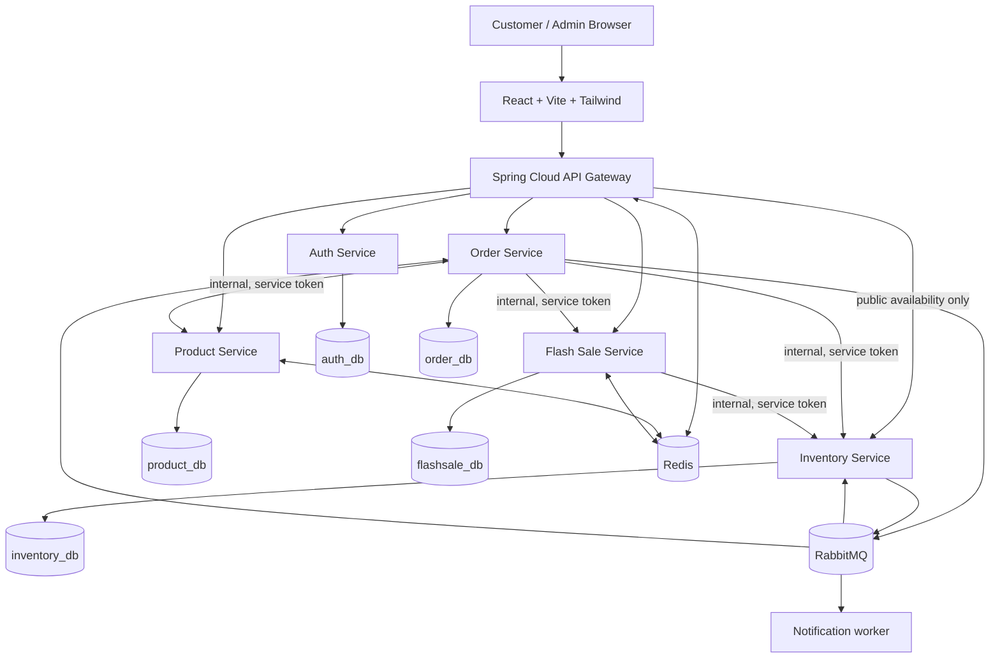
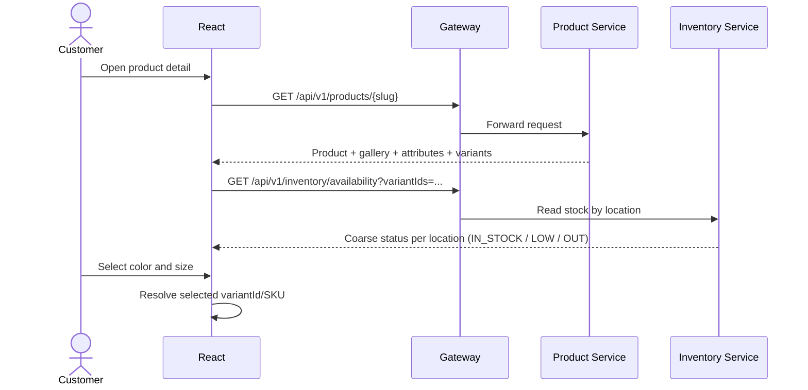
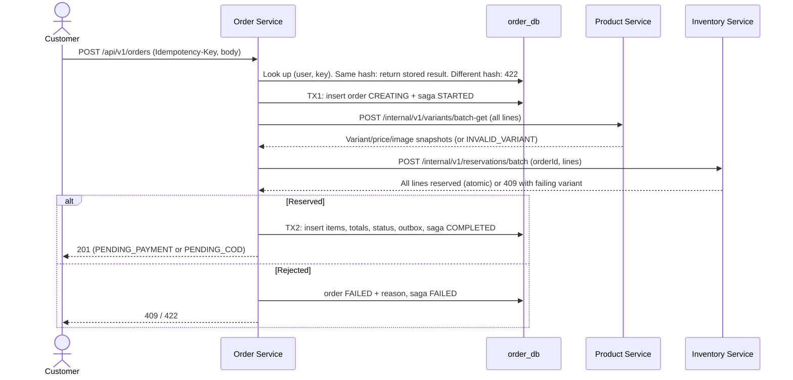
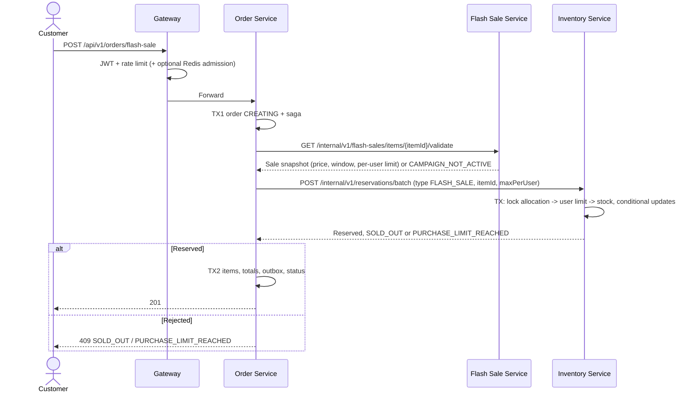
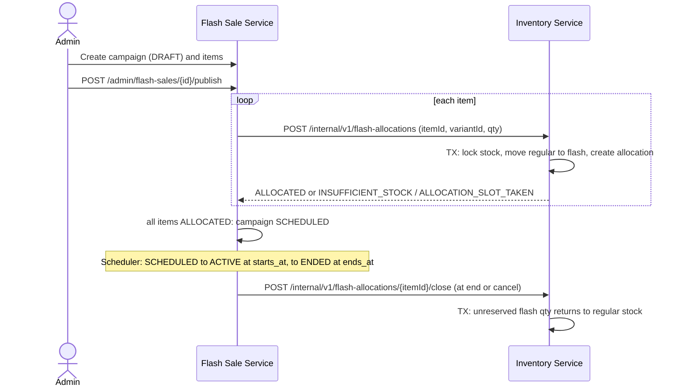

# THE C.I.U–Inspired Fashion E-commerce & Flash Sale

**Design version:** 2.1  
**Project type:** University project · 2 members · 12 weeks  
**Reference:** https://theciu.vn/  
**Stack:** Java 21, Spring Boot 3.x, Spring Cloud Gateway, React + Vite + TypeScript + Tailwind, MySQL 8, Redis, RabbitMQ, Docker Compose

> This is an independently implemented university project inspired by the public shopping flows and information architecture of the reference website. Do not reuse proprietary source code, private customer data, logos, product photographs, or brand identity without permission. Use original/demo assets and clearly identify the project as an educational replica.

## 1. Product vision and scope

Build a women's fashion e-commerce website with product variants (color/size), store-level stock visibility, cart/checkout, customer orders, and a Flash Sale capability used as the main distributed-systems demonstration.

### 1.1 Reference features to reproduce at a functional level

- Homepage sections: New Arrivals, Best Seller, On Sale, featured products.
- Product catalogue and categories: Tops, Jackets, Sets, Skirts, Dresses, Accessories, Pants, and similar.
- Product detail: image gallery, color selector, size selector, size-guide content, material/fit/design attributes, stock availability, wishlist, add-to-cart and buy-now.
- Shopping cart and checkout with recipient/address information, shipping method and payment method.
- Customer account, order history and order detail.
- Admin management for catalogue, variants, inventory, campaigns and orders.
- Static information pages: About, FAQ, shipping/payment/return policies and store directory.

### 1.2 Flash Sale is an added project capability

Flash Sale is implemented by the student team; it is not assumed to exist on the reference website. It must demonstrate time-bounded campaigns, SKU-level quota, per-user purchase limits, reservation expiry, idempotency and concurrent purchase safety.

### 1.3 Scope for two people / twelve weeks

**Must have (MVP)**
- Login/register, JWT, USER/ADMIN authorization.
- Categories, products, product images, attributes and variants.
- Color/size selection; each sellable variant has its own SKU and stock.
- Product listing, basic search/filter/sort and product detail.
- Cart, addresses, checkout, COD and simulated bank-transfer/payment states.
- Order history and admin order management.
- Inventory for one online warehouse (transactional) and 2 demo stores (read-only display).
- Flash Sale campaign management and SKU-level reservations.
- Redis caching/rate limiting; RabbitMQ events; Docker Compose.
- Automated concurrency tests and a load-test report proving no overselling in the tested scenarios.

**Should have if time permits**
- Wishlist.
- Store availability panel on product detail.
- Home-page merchandising collections.
- Customer-facing size guide and static policy/blog pages.
- Prometheus/Grafana dashboard.
- Eureka service discovery (see §3: not needed for the MVP).

**Out of scope**
- Real payment gateway, real carrier integration and live shipping-rate calculation.
- POS/warehouse ERP integration, multi-vendor marketplace, loyalty engine.
- Real foreign-currency settlement. VND is the transaction currency; a currency selector may be UI-only.
- Advanced recommendation/search engine, chat, livestream, Kubernetes and multi-region deployment.
- Automatic restock after cancelling an already-confirmed order (admin adjustment instead).

## 2. Architecture principles

1. Five business services only; do not create a service for every small feature.
2. Database ownership is per service. One MySQL server may host five isolated databases for the student deployment.
3. No cross-service foreign keys, shared repositories or direct cross-database access.
4. Product Service owns product identity and variant details. Inventory Service owns stock. Flash Sale Service owns campaign rules. Order Service owns carts and orders.
5. Every order line stores immutable product/variant/price snapshots.
6. MySQL transactions and conditional updates are the final stock-correctness boundary. Redis is never the sole ledger.
7. RabbitMQ delivery is at-least-once. Every consumer is idempotent.
8. **Cross-service writes are idempotent by construction**: reservations are keyed by `(orderId, variantId)`, orders by `(userId, Idempotency-Key)` plus a request hash.
9. **Internal APIs are never public** (see §9).
10. Prefer a clear, testable workflow over premature infrastructure complexity. If a milestone slips, cut scope using §12 rather than weakening the stock invariants.

## 3. System context and container view



### Infrastructure

| Component | Responsibility | Constraints |
|---|---|---|
| API Gateway | Public entry point, routing, CORS, JWT validation, rate limiting | Routes only `/api/**`. It must **not** route `/internal/**`. Service ports are not published to the host except the gateway and frontend. |
| Service discovery | Name resolution between services | **MVP: use Docker Compose DNS names** (`http://inventory-service:8080`) with Feign and explicit URLs from config. Eureka is optional (should-have); it adds a service, startup ordering and failure modes without helping the demo's correctness goals. |
| MySQL 8 | Durable business state | Five databases; local FKs only; `default-time-zone='+00:00'`. |
| Redis | Product/campaign cache, gateway rate limits, optional Flash Sale admission guard | TTL and invalidation explicit. Never the stock ledger (see §10). |
| RabbitMQ | Domain events and async consumers | Durable exchange/queues, publisher confirms, retry with backoff, DLQ, manual acks. |
| Docker Compose | Local integration/demo environment | One documented command starts the stack. |

## 4. Business service boundaries

| Service | Owns database | Main responsibilities | Does not own |
|---|---|---|---|
| Auth Service | `auth_db` | Users, password hashes, roles, refresh-token rotation | Profiles, orders |
| Product Service | `product_db` | Categories, product family, variants/SKUs, images, attributes, collections | Stock, reservations |
| Inventory Service | `inventory_db` | Locations, variant-level stock, Flash Sale allocations, reservations, movements, expiry worker | Product descriptions/prices, campaign dates |
| Order Service | `order_db` | Cart, wishlist, addresses, checkout, orders, payment attempts, saga, outbox/inbox | Stock updates, campaign rules |
| Flash Sale Service | `flashsale_db` | Campaign schedule/status, campaign SKU items, sale prices, per-user policy, allocation handshake | Physical stock and reservations |

Notification is a RabbitMQ worker/module, not a sixth business service.

### Boundary rules

- A **product** is the style/model on the product page. A **variant** is a sellable SKU (color + size).
- Cart and order lines reference `variantId`.
- Inventory is keyed by `(variantId, locationId)`. Online checkout reserves from the single location flagged `is_online_default`.
- Flash Sale items are SKU-level; the UI groups them under their parent product.
- Order Service stores product title, SKU, color/size, image URL and price snapshots.
- Store inventory shown on the product page is informational.

## 5. Key workflows

### 5.1 Product browsing and variant selection



The public availability endpoint returns a **coarse status**, not exact quantities, so competitors cannot scrape stock levels. Exact numbers are admin-only.

### 5.2 Normal checkout

Rule: **the order row and saga row exist before any remote call**, and `orderId` is generated by Order Service so it can be used as the reservation key.



- The batch reserve is **all-or-nothing** inside one Inventory transaction, so a partial multi-line failure needs no compensation.
- If TX2 fails after a successful reserve, the saga moves to `COMPENSATING`. A recovery job (scan `(status, next_retry_at)`) calls the idempotent batch release until it succeeds, then marks the order `FAILED`.
- Retry remote calls only when idempotent (they all are, thanks to `(orderId, variantId)`). Use explicit Feign timeouts and Resilience4j circuit breakers.

### 5.3 Flash Sale checkout



### 5.4 Payment, confirmation, COD and expiry

Confirmation is a **synchronous idempotent call** from Order Service to Inventory, so Order always learns the result. An `order.confirmed` outbox event is published as a safety net.

1. **Online / bank transfer (mock):** customer calls `POST /orders/{id}/mock-payment`. Order checks status `PENDING_PAYMENT`, then calls Inventory **confirm**.
   - Success → payment attempt `SUCCEEDED`, order `PAID`, outbox `order.paid` + `order.confirmed`.
   - `RESERVATION_EXPIRED` → payment attempt `FAILED`/`REFUNDED` (mock), order `EXPIRED`; never mark such an order `PAID`.
2. **COD:** the reservation must be confirmed **at placement**, not at delivery. In TX2 the order becomes `PENDING_COD` and Order calls Inventory confirm immediately (outbox `order.confirmed` as backup). COD orders therefore never lose their stock to the expiry worker.
3. **Cancel** (`order.cancelled`) before confirmation → Inventory releases. Cancelling an already-confirmed order is an admin action that restocks with a `STOCK_ADJUSTMENT`.
4. **Expiry:** the Inventory worker releases `HELD` reservations whose `expires_at` has passed (every ~30 s; claim rows with `SELECT ... FOR UPDATE SKIP LOCKED`, one transaction per reservation) and publishes `inventory.reservation-expired`. Order Service consumes it and moves a `PENDING_PAYMENT` order to `EXPIRED`.
5. **Single source of truth for expiry:** `reservations.expires_at` in Inventory. `orders.payment_due_at` is only a UI hint.

Suggested TTLs (configurable): 15 minutes for Flash Sale holds, 30 minutes for normal online-payment holds.

### 5.5 Flash Sale campaign lifecycle



- Allocation is idempotent by `campaignItemId`. A failed item sets `allocation_status = FAILED` with the reason; retry is manual or via the scheduler.
- Only one campaign can have an `ACTIVE` allocation for the same variant at the same location. Overlapping campaigns on the same SKU fail publish with `ALLOCATION_SLOT_TAKEN`.
- Closing returns only the unreserved quantity. Held reservations remain valid until confirmed or expired; when released after close they return to **regular** stock.

## 6. Stock and reservation model

For each `(variantId, locationId)`:

`on_hand_qty = regular_available_qty + flash_available_qty + reserved_qty`

For each Flash Sale allocation:

`allocated_qty = available_qty + reserved_qty + sold_qty + released_qty`

And, by the single-ACTIVE-allocation rule, `flash_available_qty` equals the active allocation's `available_qty` (or 0).

| Transition | Stock effect | Allocation effect |
|---|---|---|
| Allocate | regular −q, flash +q | create (`available = q`) |
| Reserve normal | regular −q, reserved +q | — |
| Reserve flash | flash −q, reserved +q | available −q, reserved +q |
| Confirm | reserved −q, on_hand −q | reserved −q, sold +q (flash) |
| Release/expire (normal) | reserved −q, regular +q | — |
| Release/expire (flash, ACTIVE) | reserved −q, flash +q | reserved −q, available +q |
| Release/expire (flash, CLOSED) | reserved −q, regular +q | reserved −q, released +q |
| Close | flash −a, regular +a | available → 0, released +a, status CLOSED |

(`a` = unreserved available quantity at close.)

**Locking:** every transaction locks in the order *allocation → user limit → stock*, and multi-line requests process lines sorted by `variantId`. Retry on deadlock (1213) / lock-wait timeout (1205) up to 3 times. Use conditional updates (`... WHERE available >= :q`) and treat 0 affected rows as "sold out".

**Reconciliation:** run the four queries in `DATABASE_DESIGN.md` §6 after every concurrency test and nightly. They must return zero rows.

**Hot-row note:** all buyers of one flash SKU serialize on two rows (allocation and stock). That is fine for a student demo; measure throughput and report it honestly rather than claiming horizontal scalability.

## 7. Messaging and reliability

Topic exchange: `commerce.events`.

| Routing key | Producer | Consumer | Action |
|---|---|---|---|
| `order.created` | Order | Notification | Confirmation message |
| `order.confirmed` | Order | Inventory, Notification | Safety net: confirm reservation if still `HELD` (no-op if already confirmed) |
| `order.paid` | Order | Notification | Receipt |
| `order.cancelled` | Order | Inventory | Release reservation |
| `order.expired` | Order | Inventory | Release reservation (no-op if already expired) |
| `inventory.reservation-expired` | Inventory | Order | Mark order/saga `EXPIRED` |

- **Transactional outbox** in **both** Order and Inventory databases: write the business change and the outbox row in one transaction; a publisher retries until the broker confirms. With several publisher instances, claim rows with `SELECT ... FOR UPDATE SKIP LOCKED`.
- **Inbox** in both databases: insert `(consumer_name, message_id)` in the same transaction as the effect; a duplicate key means "already processed, ack and skip".
- Retry with backoff, then dead-letter queue. Alert (log + metric) on DLQ depth > 0.
- Purge `PUBLISHED` outbox rows and old inbox rows after about 7 days.

## 8. Idempotency and error contract

**Idempotency**
- `POST /orders*` requires an `Idempotency-Key` header. Order stores `(user_id, key)` and a SHA-256 `request_hash` of the canonical body. Same key + same hash → return the stored response. Same key + different hash → `422 IDEMPOTENCY_KEY_REUSED`.
- Inventory reservations are idempotent by `(orderId, variantId)`; confirm/release by reservation id and current status. Repeating a final-state call returns the existing state without changing stock.

**Error codes (stable, machine-readable)**

| HTTP | Code | Meaning |
|---|---|---|
| 409 | `OUT_OF_STOCK` | Normal stock insufficient |
| 409 | `SOLD_OUT` | Flash allocation exhausted |
| 409 | `PURCHASE_LIMIT_REACHED` | Per-user flash limit |
| 409 | `RESERVATION_EXPIRED` | Confirm attempted after hold expired |
| 409 | `CAMPAIGN_NOT_ACTIVE` | Outside campaign window or status |
| 409 | `ALLOCATION_SLOT_TAKEN` | Another campaign holds the variant's flash allocation |
| 422 | `INVALID_VARIANT` | Variant missing/inactive |
| 422 | `IDEMPOTENCY_KEY_REUSED` | Same key, different payload |
| 429 | `RATE_LIMITED` | Gateway limit |

## 9. Security and API rules

- Auth Service issues short-lived JWT access tokens and rotating refresh tokens (hash stored; reuse of a revoked token revokes the token family).
- JWT `sub` is the user UUID; include role authorities and expiry. Gateway validates JWT on protected routes.
- **Internal routes** (`/internal/**`) are not routed by the gateway and are reachable only on the Docker network. Service-to-service calls also carry a short-lived **service token** (e.g. HS256 JWT per calling service, `aud` = target service, ≤ 5 min), verified by a filter. The acting user id travels as a claim/body field set by the calling service, never from a client header.
- Services never trust a client-provided `X-User-Id`.
- Admin endpoints require `ROLE_ADMIN`.
- Hash passwords with BCrypt/Argon2. Never log passwords, tokens or payment secrets.
- Explicit Feign connect/read timeouts; retries only for idempotent calls; Resilience4j circuit breakers.
- Public availability returns coarse status only.

## 10. Redis rules

- **Cache** product detail and active-campaign data with explicit TTL and invalidation on admin changes.
- **Rate limit** at the gateway (per user and per IP).
- **Optional admission guard** for Flash Sale: a counter per campaign item decremented before calling Inventory to shed load. It is a pre-filter only:
  - If the DB rejects the request or a reservation is released/expired, **increment the counter back** (compensation).
  - On startup or cache miss, rebuild the counter from `allocation.available_qty`.
  - A wrong Redis value must never cause overselling (the DB conditional update still decides) and should self-heal via reconciliation.

## 11. API surface

**Auth** — `POST /api/v1/auth/{register|login|refresh|logout}`

**Product**
- `GET /api/v1/categories`, `GET /api/v1/collections/{slug}`
- `GET /api/v1/products?keyword=&categoryId=&color=&size=&minPrice=&maxPrice=&sort=&page=&size=`
- `GET /api/v1/products/{slug}`
- Admin: `POST /api/v1/admin/products`, `POST /api/v1/admin/products/{productId}/variants`, `PUT /api/v1/admin/variants/{variantId}`
- Internal: `POST /internal/v1/variants/batch-get` (ids → price, SKU, color, size, image, status)

**Inventory**
- Public: `GET /api/v1/inventory/availability?variantIds=...` (coarse status)
- Internal: `POST /internal/v1/reservations/batch` (all-or-nothing), `POST /internal/v1/reservations/{id}/confirm`, `POST /internal/v1/reservations/{id}/release`, `POST /internal/v1/orders/{orderId}/reservations/release` (batch release for compensation)
- Internal: `POST /internal/v1/flash-allocations` (idempotent by `campaignItemId`), `POST /internal/v1/flash-allocations/{campaignItemId}/close`
- Admin: `GET/PUT /api/v1/admin/inventory/...` (upsert stock after validating the variant with Product Service), `POST /api/v1/admin/inventory/adjustments`

**Flash Sale**
- `GET /api/v1/flash-sales/active`, `GET /api/v1/flash-sales/{campaignId}`
- Admin: `POST /api/v1/admin/flash-sales`, `POST .../{campaignId}/items`, `POST .../{campaignId}/publish`, `POST .../{campaignId}/close`
- Internal: `GET /internal/v1/flash-sales/items/{campaignItemId}/validate`

**Order / Customer**
- `GET/POST /api/v1/cart/items`, `PATCH/DELETE /api/v1/cart/items/{cartItemId}`
- `GET/POST/PUT/DELETE /api/v1/addresses`, `GET/POST /api/v1/wishlist/items`
- `POST /api/v1/orders`, `POST /api/v1/orders/flash-sale`, `GET /api/v1/orders`, `GET /api/v1/orders/{orderId}`
- `POST /api/v1/orders/{orderId}/mock-payment`, `POST /api/v1/orders/{orderId}/cancel`

## 12. Delivery plan, risks and scope cuts

### 12.1 Suggested 12-week plan (2 members)

| Weeks | Goal | Exit check |
|---|---|---|
| 1 | Repo, Compose (MySQL, Redis, RabbitMQ), Flyway per service, Auth | Register/login with JWT works through the gateway |
| 2–3 | Product Service + catalogue UI (variants, images, attributes) | Browse and select color/size |
| 4 | **Inventory core** + reservation/confirm/release + **concurrency tests** | Test T1–T3 pass, reconciliation clean |
| 5–6 | Cart, addresses, normal checkout, COD, outbox/inbox, expiry worker | Checkout survives duplicate requests and a killed service |
| 7–8 | Flash Sale Service, allocation handshake, flash checkout | Test T4–T8 pass |
| 9 | Redis cache/rate limit, RabbitMQ retry/DLQ, admin screens | Rate limit demo, DLQ demo |
| 10 | Frontend polish, static pages, optional wishlist/stores | Acceptance walkthrough |
| 11 | Load test + report (k6/JMeter) | Report with raw numbers and reconciliation output |
| 12 | Buffer, docs, demo script | Freeze at start of the week |

Build the Inventory concurrency tests **before** the UI around them; they are the evidence for the project's main claim.

### 12.2 Risks

| Risk | Mitigation |
|---|---|
| Distributed saga bugs eat the schedule | Batch reserve is atomic; keep the saga to a few steps plus a recovery job |
| Deadlocks under load | Global lock order, sorted lines, bounded retries, test with many users |
| Redis and DB drift | DB is authoritative; compensate on reject/release; reconcile |
| Too many moving parts for 2 people | Drop Eureka, wishlist, collections, store panel first (in this order) |
| Hot-row throughput limit | Report measured numbers honestly; do not claim linear scaling |

### 12.3 Fallback

If the course does not require microservices, a **modular monolith** (same module boundaries and separate schemas, in-process calls, the same outbox/inbox only where asynchrony is needed) keeps every invariant in this document and removes most of the distributed-systems risk. Decide this by the end of week 1.

## 13. Deployment topology and repository structure

Docker Compose services:
- `frontend`, `api-gateway`
- `auth-service`, `product-service`, `inventory-service`, `order-service`, `flash-sale-service`
- `mysql`, `redis`, `rabbitmq`
- Optional: `eureka-server`, `notification-worker`, `prometheus`, `grafana`

```text
fashion-ecommerce-flash-sale/
├── frontend/
├── services/
│   ├── api-gateway/
│   ├── auth-service/
│   ├── product-service/
│   ├── inventory-service/
│   ├── order-service/
│   └── flash-sale-service/
├── infrastructure/
│   ├── docker-compose.yml
│   ├── mysql/init/
│   ├── rabbitmq/
│   └── monitoring/
├── tests/
│   ├── concurrency/
│   └── load/
└── docs/
    ├── SRS.md
    ├── ARCHITECTURE.md
    ├── DATABASE_DESIGN.md
    └── API_SPECIFICATION.md
```

## 14. Acceptance criteria and test plan

### 14.1 Acceptance criteria

- A customer can browse a product, select a color/size variant and add that variant to the cart.
- Different variants have different SKU and stock.
- Product detail shows coarse availability by demo location.
- A standard order reserves the correct variants at the online fulfilment location, all-or-nothing.
- A Flash Sale campaign can target one or more variants and enforce per-user limits.
- COD orders keep their stock (reservation confirmed at placement).
- Duplicate checkout requests and duplicate RabbitMQ messages do not duplicate business effects.
- Admin can manage products, variants, stock, campaigns and orders.
- `docker compose up` starts the complete demo stack.

### 14.2 Mandatory automated tests

| ID | Scenario | Expected |
|---|---|---|
| T1 | 150 concurrent flash requests, 20 units, 60 users, limit 2 | Exactly 20 reserved, rest `SOLD_OUT`, no negative stock, reconciliation clean |
| T2 | Same user fires many parallel requests | Never exceeds `max_qty_per_user` |
| T3 | Normal checkout, many users, little stock | No negative `regular_available_qty` |
| T4 | Replay same `Idempotency-Key` + same body | One order, same response |
| T5 | Same key, different body | `422 IDEMPOTENCY_KEY_REUSED` |
| T6 | Multi-line order, one line out of stock | No reservation remains for any line |
| T7 | Kill Order Service between reserve and TX2 | Recovery job releases the reservation |
| T8 | Deliver `order.cancelled` / `order.expired` twice | Stock changes once |
| T9 | COD order older than the hold TTL | Reservation still `CONFIRMED`, stock not restored |
| T10 | Pay after expiry | `RESERVATION_EXPIRED`; order `EXPIRED`, never `PAID` |
| T11 | Release a flash hold after campaign close | Quantity returns to **regular** stock |
| T12 | Two Inventory instances run the expiry worker | Each reservation expires exactly once |
| T13 | Overlapping campaigns on one variant | Second publish fails `ALLOCATION_SLOT_TAKEN` |

A smoke version of T1 with the documented lock order was run during this revision against MySQL 8 (20 reserved / 130 sold out / reconciliation clean); the full suite must be automated against the real services.
