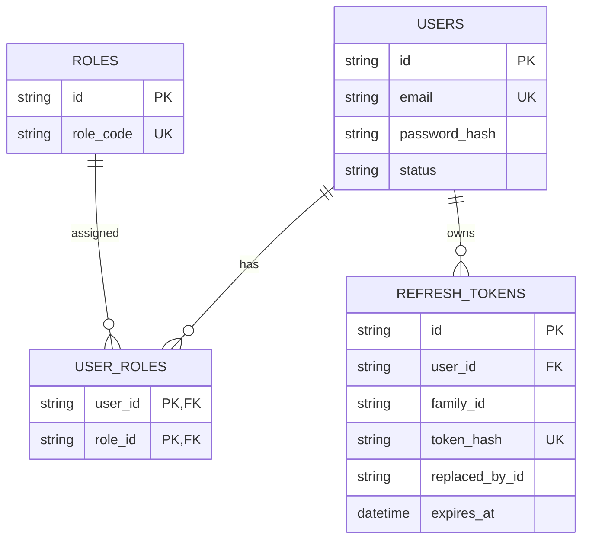
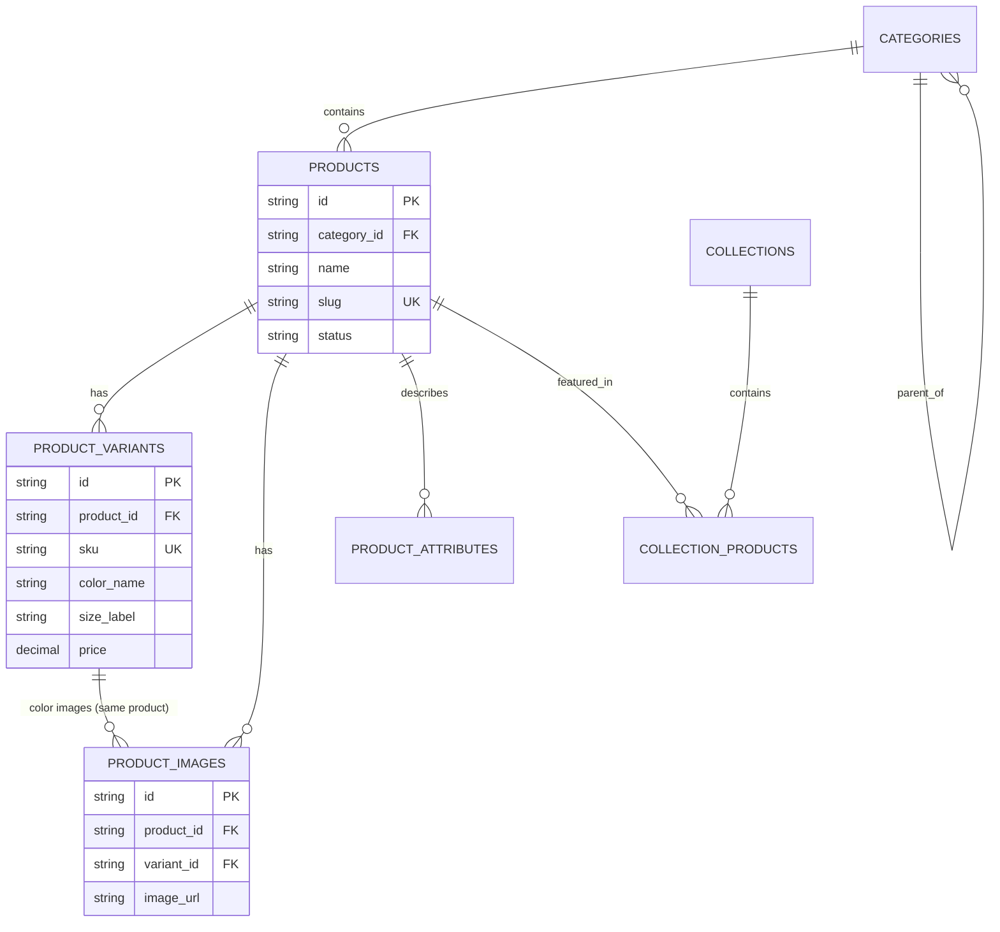
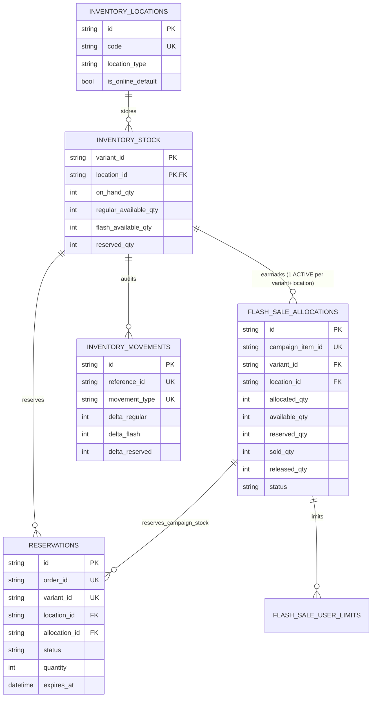
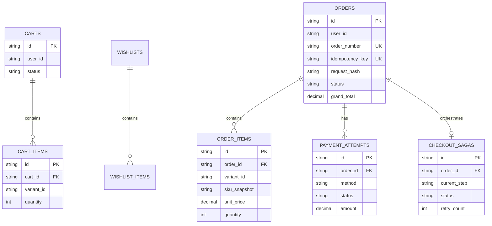
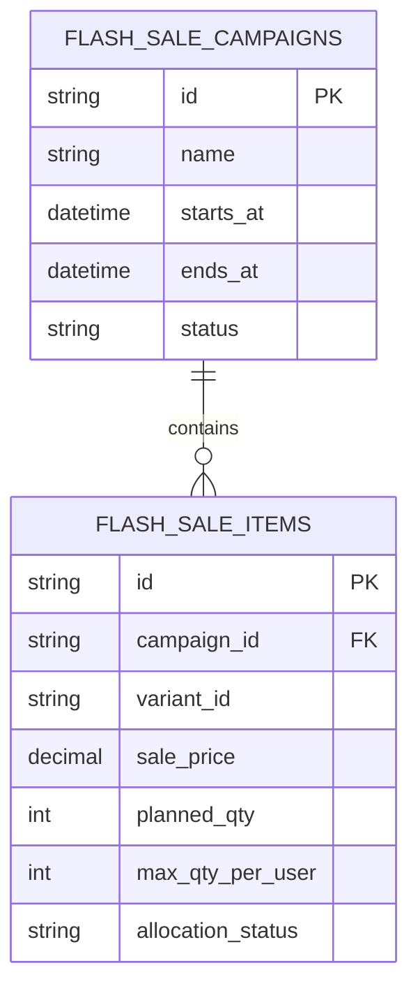

# Fashion E-commerce & Flash Sale — Database Design

**Design version:** 2.1  
**Engine:** MySQL 8 / InnoDB (validated on 8.0.x)  
**Conventions:** UUID `CHAR(36)`; money is **whole VND** `DECIMAL(14,0)`; UTC `DATETIME(6)`; quantity `INT`; soft status instead of hard delete for business records.

> v2.1 fixes the gaps found in the v2.0 review. Every constraint and reconciliation query in this document was executed against MySQL 8 (see §8 for what was verified).

## 1. Core modeling decisions

### Product versus variant

- `products` is the style/model shown on a product page (e.g. Lady Tank Top).
- `product_variants` is the sellable SKU (e.g. Lady Tank Top / Black / M). It owns SKU, color, size, price and status.
- `color_name` and `size_label` are **NOT NULL** (defaults `DEFAULT` / `ONE_SIZE`). A UNIQUE key treats NULLs as distinct, so nullable columns would allow duplicate free-size variants.
- Cart lines, order lines, inventory and Flash Sale items reference `variant_id`.
- Business rows are never hard-deleted. `product → variants` is `ON DELETE RESTRICT` because Inventory and Orders hold external references to variant ids.

### Stock by location

Inventory is keyed by `(variant_id, location_id)`. Exactly one location is flagged `is_online_default`; online checkout and Flash Sale allocations use it. Store rows are informational in the MVP (branch pickup is optional).

### Money

VND has no minor unit, so all money columns are `DECIMAL(14,0)`. `orders.currency` is constrained to `VND`. Discounts and shipping are computed in whole dong; round once, in the Order Service, when building the snapshot.

### Service ownership

| Database | Owner | Tables |
|---|---|---|
| `auth_db` | Auth Service | users, roles, user_roles, refresh_tokens |
| `product_db` | Product Service | categories, products, product_variants, product_images, product_attributes, collections, collection_products |
| `inventory_db` | Inventory Service | inventory_locations, inventory_stock, flash_sale_allocations, flash_sale_user_limits, reservations, inventory_movements, **outbox_events, inbox_messages** |
| `order_db` | Order Service | carts, cart_items, wishlists, wishlist_items, customer_addresses, orders, order_items, payment_attempts, checkout_sagas, outbox_events, inbox_messages |
| `flashsale_db` | Flash Sale Service | flash_sale_campaigns, flash_sale_items |

One MySQL instance can host the five databases in development. Each service has its own DB credentials and Flyway history. No cross-database foreign keys or direct table reads (the validation script confirms zero cross-database FKs).

## 2. Entity relationship diagrams

### 2.1 Auth DB



### 2.2 Product DB



### 2.3 Inventory DB



`inventory_db` also contains `outbox_events` and `inbox_messages` (same shape as in Order DB, not drawn).

### 2.4 Order DB



`user_id` in carts, wishlists, addresses and orders references Auth logically; there is no cross-database FK. `customer_addresses`, `outbox_events`, `inbox_messages` are not drawn.

### 2.5 Flash Sale DB



`product_id` and `variant_id` are external Product Service references, not foreign keys.

## 3. Table definitions and business rules

### 3.1 `auth_db`

- **`users`** — UUID PK; `email` unique and normalized to lowercase by the service; `password_hash` BCrypt/Argon2 only; `status` ∈ `ACTIVE | LOCKED | DISABLED`.
- **`roles`, `user_roles`** — roles `ROLE_USER`, `ROLE_ADMIN`; composite PK with local FKs.
- **`refresh_tokens`** — store a hash, never the raw token. Each token has a `family_id`; on refresh, mark the old token `revoked_at` and set `replaced_by_id`. If a **revoked** token is presented again, revoke the whole family (reuse detection).

### 3.2 `product_db`

- **`categories`** — optional `parent_id` (local FK), unique `slug`, `sort_order`, `status`.
- **`products`** — product family/style; status `DRAFT | ACTIVE | INACTIVE | ARCHIVED`. No stock here. No `is_featured` flag: "featured" is a collection.
- **`product_variants`** — sellable SKU; unique `sku` and unique `(product_id, color_name, size_label)`; `price`, optional `compare_at_price` (≥ price); status `ACTIVE | INACTIVE | OUT_OF_CATALOG`. Also has `UNIQUE (id, product_id)` so images can use a composite FK.
- **`product_images`** — `variant_id IS NULL` = product-level image. When set, the composite FK `(variant_id, product_id)` guarantees the variant belongs to the same product. Use original/demo assets.
- **`product_attributes`** — normalized keys (`material`, `fit`, `composition`, `design_detail`), unique per product.
- **`collections`, `collection_products`** — merchandising groups (New Arrivals, Best Seller, Featured). `ON_SALE` is derived from active Flash Sale data, not stored.
- **Search** — the MVP uses `LIKE` on `products.name` (`idx_products_name`). The default InnoDB FULLTEXT parser ignores tokens shorter than `innodb_ft_min_token_size` (3), so short Vietnamese words such as "áo" would never match.

### 3.3 `inventory_db`

- **`inventory_locations`** — `code` unique, type `ONLINE_WAREHOUSE | STORE`. Exactly one row may have `is_online_default = 1` (enforced by a generated-column UNIQUE key), and only for `ONLINE_WAREHOUSE`. Seed one online location and 2–3 demo stores.
- **`inventory_stock`** — PK `(variant_id, location_id)`.
  - Buckets: `on_hand_qty`, `regular_available_qty`, `flash_available_qty`, `reserved_qty`.
  - CHECK: all ≥ 0 and `on_hand = regular + flash + reserved`.
  - Rows are created by the Inventory admin API after the variant is validated with Product Service.
  - `version` is for diagnostics/admin optimistic edits; hot-path correctness comes from row locks and conditional updates.
- **`flash_sale_allocations`** — quantity of one variant at one location earmarked for one campaign item.
  - `allocated = available + reserved + sold + released` (CHECK).
  - **At most one `ACTIVE` allocation per `(variant_id, location_id)`** (generated `active_slot` UNIQUE key). Campaigns that overlap on the same variant and location cannot both be active, so `stock.flash_available_qty` always equals the single active allocation's `available_qty`.
  - A `CLOSED` allocation must have `available_qty = 0` (CHECK).
  - Quantity meanings: `available` can be reserved; `reserved` is held by `HELD` reservations; `sold` is confirmed; `released` was returned to regular stock because the allocation was closed.
  - Allocation must be transferred from regular available stock.
- **`flash_sale_user_limits`** — PK `(campaign_item_id, user_id)`. CHECK `reserved + purchased <= max_qty_per_user`. Created lazily with `INSERT ... ON DUPLICATE KEY UPDATE` (no-op) followed by `SELECT ... FOR UPDATE`.
- **`reservations`** — one row per `(order_id, variant_id)` (**UNIQUE**, this is the idempotency key). `order_id` is pre-generated by Order Service before the order row exists.
  - `reservation_type` ∈ `NORMAL | FLASH_SALE`; `status` ∈ `HELD | CONFIRMED | RELEASED | EXPIRED`.
  - A NORMAL reservation has no allocation; a FLASH_SALE reservation must have one, and the composite FK forces the allocation's variant and location to match.
  - `expires_at` is the **authoritative** hold expiry. `confirmed_at`, `released_at`, `release_reason` record the outcome.
- **`inventory_movements`** — append-only audit log.
  - Each row stores signed deltas **and** resulting balances for all four buckets.
  - CHECKs: `delta_on_hand = delta_regular + delta_flash + delta_reserved` and the same for the `after_*` balances.
  - `UNIQUE (reference_type, reference_id, movement_type)` makes every movement idempotent (`reference_id` = reservation id, or allocation id for allocate/close).
  - Types: `INITIAL_STOCK`, `STOCK_ADJUSTMENT`, `ALLOCATE_FLASH`, `CLOSE_CAMPAIGN`, `RESERVE_NORMAL`, `RESERVE_FLASH`, `CONFIRM`, `RELEASE`, `EXPIRE`.
- **`outbox_events`, `inbox_messages`** — Inventory publishes `inventory.reservation-expired` and consumes `order.confirmed`, `order.cancelled`, `order.expired`. Inbox PK is `(consumer_name, message_id)`.

### 3.4 `order_db`

- **`carts`, `cart_items`** — exactly one **ACTIVE** cart per user (generated `active_user_id` UNIQUE key; `CONVERTED` carts do not block a new one). Cart line references `variant_id`, unique `(cart_id, variant_id)`. Cart price is advisory; revalidate price, SKU status and stock at checkout.
- **`wishlists`, `wishlist_items`** — optional; references `product_id`; unique `(wishlist_id, product_id)`.
- **`customer_addresses`** — saved addresses; `user_id` is the external Auth ID.
- **`orders`**
  - `id` is generated by the application before calling Inventory; it becomes the reservations' `order_id`.
  - Idempotency: unique `(user_id, idempotency_key)` plus `request_hash` (SHA-256 of the canonical request). Replay with the same hash returns the stored result; same key with a different hash is rejected (422).
  - Address and recipient are snapshotted on the order.
  - `shipping_method` ∈ `STANDARD | EXPRESS` (mock); `payment_method` ∈ `COD | BANK_TRANSFER | MOCK_ONLINE`.
  - CHECKs: `currency = 'VND'` and `grand_total = subtotal - discount_total + shipping_fee`.
  - `payment_due_at` is informational for the UI; the authoritative hold expiry is the reservation's `expires_at`. `confirmed_at` and `cancel_reason` are filled by the workflow.
  - States: `CREATING`, `PENDING_PAYMENT`, `PENDING_COD`, `PAID`, `PROCESSING`, `SHIPPED`, `COMPLETED`, `CANCELLED`, `EXPIRED`, `FAILED`.
- **`order_items`** — immutable snapshots (`product_id`, `variant_id`, name, SKU, color, size, image, price). CHECK `line_total = unit_price * quantity - discount_amount`. Unique `(order_id, variant_id)` (one line per variant). Optional external campaign ids.
- **`payment_attempts`** — provider/method, reference, amount, status, idempotency key. COD creates no attempt. For the demo, outcomes are simulated.
- **`checkout_sagas`** — inserted in the **same transaction as the order row** (status `CREATING`) before any remote call. Tracks `current_step`, `status`, `retry_count`, `next_retry_at`; the recovery job scans `(status, next_retry_at)`.
- **`outbox_events`, `inbox_messages`** — outbox written in the same transaction as the business change; inbox `(consumer_name, message_id)` deduplicates deliveries.

### 3.5 `flashsale_db`

- **`flash_sale_campaigns`** — `name`, unique `code`, `starts_at`, `ends_at` (`ends_at > starts_at`), status `DRAFT | SCHEDULED | ACTIVE | ENDED | CANCELLED`.
- **`flash_sale_items`** — one row per campaign variant; unique `(campaign_id, variant_id)`; `sale_price ≥ 0`; `planned_qty > 0`; `1 ≤ max_qty_per_user ≤ planned_qty`.
  - `allocation_status` ∈ `PENDING | ALLOCATED | FAILED | CLOSED` tracks the handshake with Inventory. A campaign can become `SCHEDULED` only when every item is `ALLOCATED`.
  - In the MVP the allocation covers the whole `planned_qty` at the online default location.

## 4. Important indexes and constraints

- **Unique:** `products.slug`, `product_variants.sku`, `(product_id, color_name, size_label)`, `campaign.code`, `(campaign_id, variant_id)`, `orders (user_id, idempotency_key)`, `reservations (order_id, variant_id)`, `inventory_movements (reference_type, reference_id, movement_type)`, one ACTIVE allocation per variant+location, one ACTIVE cart per user, one default online location.
- **Product browsing:** `(status, category_id)`, `products.name`, `product_variants (product_id, status, sort_order)`, `collection_products (collection_id, sort_order)`.
- **Inventory:** `(variant_id, location_id)` PK; reservations `(status, expires_at)` for the expiry worker; allocation `(campaign_item_id, location_id)`.
- **Orders:** `(user_id, created_at)`, admin queue `(status, created_at)`, saga recovery `(status, next_retry_at)`.
- **Outbox:** `(status, next_attempt_at, created_at)`.
- **Time zone:** run MySQL with `default-time-zone='+00:00'` and use `connectionTimeZone=UTC` in JDBC; `CURRENT_TIMESTAMP` follows the session time zone.

## 5. Transaction rules that must be implemented

### 5.1 Global lock order (prevents deadlocks)

Every Inventory transaction acquires locks in this order, and only the ones it needs:

1. `flash_sale_allocations` (by `campaign_item_id, location_id`)
2. `flash_sale_user_limits` (by `campaign_item_id, user_id`)
3. `inventory_stock` (by `variant_id, location_id`)
4. insert/update `reservations` and insert `inventory_movements`

For multi-line orders, process the lines **sorted by `variant_id`** so two orders never lock the same rows in opposite order. Retry a transaction on MySQL error 1213 (deadlock) or 1205 (lock wait timeout), at most 3 times.

### 5.2 Normal reservation (per line, in one transaction for the whole order)

1. If a reservation for `(order_id, variant_id)` already exists, return it (idempotent replay).
2. Lock the stock row `(variant_id, online_location_id)`.
3. Conditional update: `UPDATE inventory_stock SET regular_available_qty = regular_available_qty - :q, reserved_qty = reserved_qty + :q WHERE ... AND regular_available_qty >= :q`; 0 rows affected ⇒ out of stock.
4. Insert `HELD` reservation (`expires_at = now + hold TTL`) and a `RESERVE_NORMAL` movement.
5. A multi-line reserve call is **all-or-nothing**: if any line fails, roll back the whole transaction.

### 5.3 Flash Sale reservation

1. Lock the allocation row; verify `status = 'ACTIVE'` and `available_qty >= :q`.
2. Create the user-limit row if missing (`INSERT ... ON DUPLICATE KEY UPDATE` no-op), then lock it; verify `reserved_qty + purchased_qty + :q <= max_qty_per_user`.
3. Lock the stock row. Update the allocation (`available -= q`, `reserved += q`), stock (`flash_available -= q`, `reserved += q`) and the user limit (`reserved += q`) with conditional `WHERE` clauses.
4. Insert `HELD` reservation (with `allocation_id`) and a `RESERVE_FLASH` movement. Commit.

### 5.4 Confirm

Only `HELD → CONFIRMED`. If the reservation is already `CONFIRMED`, return it unchanged. If it is `EXPIRED` or `RELEASED`, return error `RESERVATION_EXPIRED` and apply nothing.

- Stock: `reserved -= q`, `on_hand -= q`.
- Flash only: allocation `reserved -= q`, `sold += q`; user limit `reserved -= q`, `purchased += q`.

### 5.5 Release / expire

Only `HELD → RELEASED | EXPIRED`; repeated calls return the existing final state. Stock: `reserved -= q`, then restore the correct bucket:

| Reservation | Allocation state | Stock effect | Allocation effect |
|---|---|---|---|
| NORMAL | — | `regular_available += q` | — |
| FLASH_SALE | `ACTIVE` | `flash_available += q` | `reserved -= q`, `available += q` |
| FLASH_SALE | `CLOSED` | `regular_available += q` | `reserved -= q`, `released += q` |

Flash reservations also do `user_limit.reserved -= q`. The `CLOSED` row matters: a hold that outlives its campaign must return to **regular** stock, never to a closed flash bucket.

### 5.6 Allocate / close a campaign item

- **Allocate** (idempotent by `campaign_item_id` + location): lock stock; require `regular_available_qty >= qty` and no existing ACTIVE allocation for the same variant+location; move `qty` from regular to flash; insert the allocation and an `ALLOCATE_FLASH` movement.
- **Close:** lock the allocation, then stock; set `released += available`, `flash_available -= available`, `regular_available += available`, `available = 0`, `status = 'CLOSED'`, `closed_at = now`; insert `CLOSE_CAMPAIGN` movement. Held reservations are **not** touched; they are confirmed or released/expired later (§5.5).

### 5.7 Cancelling after confirmation

Out of scope for the automatic flow. In the MVP an admin restocks a cancelled, already-confirmed order through a `STOCK_ADJUSTMENT` movement.

## 6. Reconciliation queries (run in tests and as a nightly job)

All four must return **zero rows** on healthy data:

```sql
-- R1: flash bucket equals the single ACTIVE allocation's available quantity
SELECT s.variant_id, s.location_id, s.flash_available_qty, COALESCE(a.available_qty,0) AS alloc_available
FROM inventory_stock s
LEFT JOIN flash_sale_allocations a
  ON a.variant_id = s.variant_id AND a.location_id = s.location_id AND a.status = 'ACTIVE'
WHERE s.flash_available_qty <> COALESCE(a.available_qty,0);

-- R2: stock.reserved_qty equals the sum of HELD reservations
SELECT s.variant_id, s.location_id, s.reserved_qty, COALESCE(SUM(r.quantity),0) AS held_qty
FROM inventory_stock s
LEFT JOIN reservations r
  ON r.variant_id = s.variant_id AND r.location_id = s.location_id AND r.status = 'HELD'
GROUP BY s.variant_id, s.location_id, s.reserved_qty
HAVING s.reserved_qty <> COALESCE(SUM(r.quantity),0);

-- R3: allocation.reserved_qty equals the sum of its HELD reservations
SELECT a.id, a.reserved_qty, COALESCE(SUM(r.quantity),0) AS held_qty
FROM flash_sale_allocations a
LEFT JOIN reservations r ON r.allocation_id = a.id AND r.status = 'HELD'
GROUP BY a.id, a.reserved_qty
HAVING a.reserved_qty <> COALESCE(SUM(r.quantity),0);

-- R4: user-limit reserved_qty equals that user's HELD reservations for the item
SELECT l.campaign_item_id, l.user_id, l.reserved_qty, COALESCE(SUM(r.quantity),0) AS held_qty
FROM flash_sale_user_limits l
LEFT JOIN flash_sale_allocations a ON a.campaign_item_id = l.campaign_item_id
LEFT JOIN reservations r ON r.allocation_id = a.id AND r.user_id = l.user_id AND r.status = 'HELD'
GROUP BY l.campaign_item_id, l.user_id, l.reserved_qty
HAVING l.reserved_qty <> COALESCE(SUM(r.quantity),0);
```

## 7. Rules the database cannot enforce (implement in the services)

| Rule | Where |
|---|---|
| `flash_sale_items.sale_price` below the current variant price; variant exists and is `ACTIVE` | Flash Sale Service (validates with Product Service) |
| `orders.subtotal = SUM(order_items.line_total)` | Order Service (assert before commit) |
| Sum of allocations per campaign item ≤ `planned_qty` | Inventory Service (MVP: one allocation = whole `planned_qty`) |
| Stock row exists only for a real variant | Inventory admin API validates with Product Service |
| Cart quantity caps and maximum number of cart lines | Order Service |
| Retention: purge `PUBLISHED` outbox rows and old inbox rows (e.g. after 7 days) | Scheduled cleanup per service |

## 8. What was verified

The v2.1 `schema.sql` was loaded into MySQL 8.0 (32 tables, zero cross-database FKs, re-runnable) and 36 behavioural checks passed, including: duplicate free-size variants rejected; image/variant product mismatch rejected; second `ACTIVE` cart rejected but a new cart after `CONVERTED` accepted; second default online location rejected; second `ACTIVE` allocation for the same variant+location rejected; closed allocation with available stock rejected; mismatched flash allocation/location rejected; duplicate `(order, variant)` reservation rejected; inconsistent movement deltas rejected; wrong `grand_total` / `line_total` rejected.

A concurrency smoke test of §5.3 with the §5.1 lock order (150 simultaneous attempts, 60 users, 20 units, limit 2 per user) produced exactly 20 reservations, 130 `SOLD_OUT`, no negative stock, no deadlock, and all four reconciliation queries returned zero rows. A deliberately corrupted bucket was detected by R2. Re-run these against the exact MySQL version and driver you ship.

## 9. Scope notes

- VND is the only settlement currency in the MVP. If a currency selector is recreated, label it display-only.
- Static policy/FAQ/blog pages are frontend pages; no CMS database is needed for the first release.
- Exchange/return workflow is a future feature; a static policy page is enough.
- This is a starter design. Generate Flyway migrations per service; do not share one migration folder or DB credentials across services.
